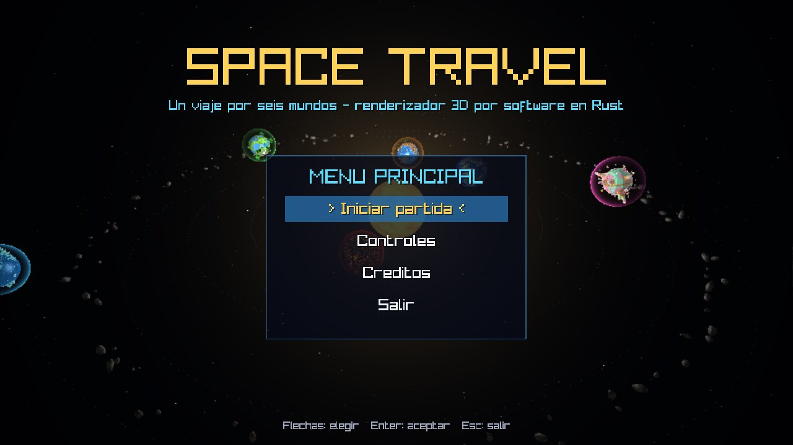
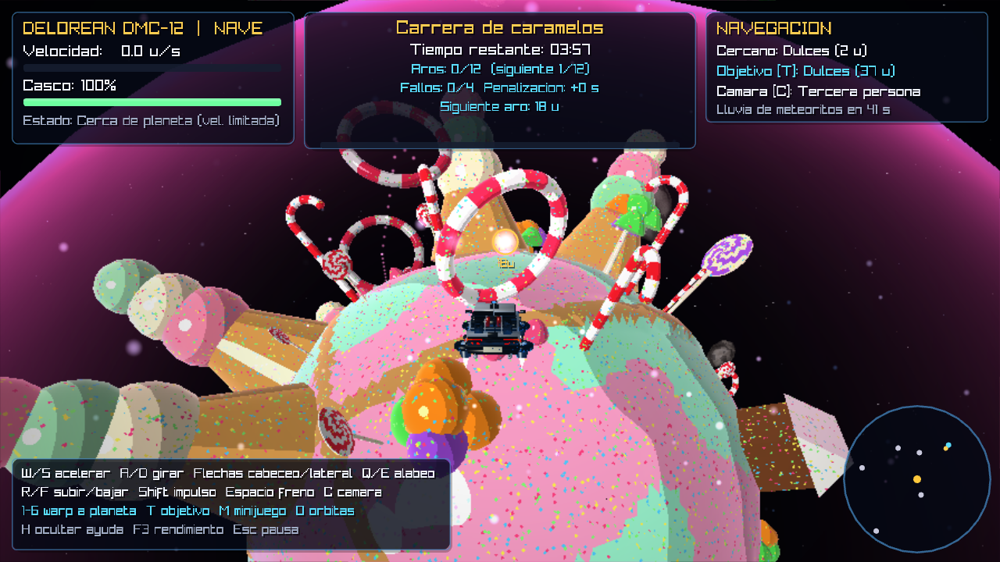

# Space Travel — renderizador 3D por software en Rust

Proyecto final de **Gráficas por Computadora**. Es un videojuego espacial 3D
en el que se despega desde la Tierra en un cohete, se libera un vehículo
inspirado en el DeLorean y se explora libremente un sistema solar con seis
planetas temáticos, cinco minijuegos, una lluvia de meteoritos y un cinturón
de asteroides.

**Todo el renderizado 3D se hace en la CPU** con un pipeline propio
(`src/renderer.rs` y `src/shaders.rs`). raylib solo crea la ventana, lee
teclado y ratón, muestra el framebuffer ya calculado y dibuja el texto 2D del
HUD. No se usan cámaras 3D, modelos, shaders de GPU ni OpenGL de raylib para
la escena.



## Tecnologías

- Rust 2024 (probado con rustc 1.97).
- [raylib-rs 6](https://crates.io/crates/raylib): ventana, entrada,
  textura del framebuffer y texto 2D.
- Ninguna otra dependencia. El lector OBJ/MTL, las matemáticas, la
  rasterización, los shaders, la generación procedural, las colisiones y la
  lógica del juego se escribieron para este proyecto.

## Requisitos del sistema

- Rust (rustup/Cargo), CMake y un compilador C/C++: los *bindings* nativos
  de raylib se compilan la primera vez.
- Windows: Visual Studio Build Tools. Linux: `libx11-dev libxrandr-dev
  libxinerama-dev libxcursor-dev libxi-dev libgl1-mesa-dev`.
- Una CPU de 4 núcleos o más se recomienda: el rasterizador detecta y usa
  automáticamente todos los procesadores lógicos disponibles.

## Instalación y ejecución

```bash
cargo run --release
```

Otros comandos:

```bash
cargo run --release -- --benchmark
```

```bash
cargo run --release -- --captura hielo captura.ppm 960 540
```

```bash
cargo run --release --bin generar_modelos
```

| Comando / variable | Uso |
|---|---|
| `--benchmark` | Mide tiempos por cuadro reales en 14 escenas. |
| `--captura <escena> <archivo.ppm> [ancho alto]` | Renderiza una escena sin ventana (escenas: `menu`, `cuenta`, `encendido`, `despegue`, `ascenso`, `separacion`, `despliegue`, `vuelo`, `sistema`, `primera_persona`, `orbital`, `meteoritos`, `<planeta>`, `superficie_<planeta>`, `minijuego_<planeta>`). |
| `generar_modelos` | Regenera los OBJ/MTL procedurales en `recursos/modelos`. |
| `SPACE_TRAVEL_SEED=<n>` | Semilla de las decoraciones y la lluvia de meteoritos (por defecto 20261109). |
| `SPACE_TRAVEL_ESCENA` + `SPACE_TRAVEL_AUTOSHOT=<cuadros>:<ruta relativa.png>` | Abre la ventana en una escena y guarda una captura real (así se generaron las imágenes de `docs/capturas`). |

No es necesario elegir calidad ni cantidad de hilos. El juego apunta siempre
a **60 FPS**, usa todos los procesadores lógicos y ajusta automáticamente el
render 3D entre 896x504 y 1280x720. Comienza en 1152x648, baja con rapidez si
una escena no deja margen y solo sube tras varios segundos de rendimiento
estable. El HUD se mantiene a la resolución completa de la ventana.



## Controles

| Tecla | Acción |
|---|---|
| `W` / `S` | Acelerar / frenar y retroceder |
| `A` / `D` | Guiñada (girar) |
| `↑` / `↓` | Cabeceo (subir / bajar el morro) |
| `Q` / `E` | Alabeo |
| `←` / `→` | Desplazamiento lateral |
| `R` / `F` | Ascender / descender |
| `Shift` | Impulso |
| `Espacio` | Freno (en la cinemática: saltarla) |
| `1`–`6` | Warp animado a Tierra, Hielo, Oasis, Fuego, Dulces y Escandalosos |
| `T` | Cambiar el planeta objetivo (flecha y distancia en el HUD) |
| `C` | Cambiar cámara |
| Ratón (arrastrar) / `I J K L` | Rotar la cámara orbital |
| Rueda o `+` / `-` | Zoom de la cámara |
| `M` | Abrir / salir del minijuego del planeta cercano |
| `Enter` / `R` | En un minijuego: comenzar / reintentar |
| `O` / `H` / `F3` | Órbitas / ayuda / estadísticas de rendimiento |
| `Retroceso` | Reaparecer en órbita terrestre |
| `Esc` / `P` | Pausa (continuar, reiniciar, volver al menú, salir) |
| `F12` | Captura de pantalla |

## Cámaras

- **Tercera persona** (predeterminada): sigue a la nave desde atrás con
  suavizado exponencial por delta time; la distancia se ajusta con zoom.
- **Primera persona**: desde la cabina del DeLorean, con retícula; la nave
  se oculta y la cámara gira con su alabeo.
- **Orbital**: gira alrededor de la nave (ratón o `IJKL`, rotación
  automática lenta) con zoom.

Al cambiar de modo, la cámara se interpola durante 0,45 s para no saltar.

## Planetas

| Planeta | Modelo | Shader | Identidad | Minijuego |
|---|---|---|---|---|
| Tierra | `planetas/tierra/Tierra.obj` (+ `Nubes.obj`, `Plataforma.obj`) | `Earth` + `Cloud` | Océanos con brillo especular, continentes, casquetes, luces de ciudades nocturnas, nubes con prueba alfa | Escenario de lanzamiento |
| Hielo | `planetas/hielo/Hielo.obj` (original del equipo) + `cristal.obj`, `roca_helada.obj` | `Ice` | Escarcha procedural, grietas, destellos que titilan, ventisca y tinte de escarcha en pantalla | **Cristales perdidos** |
| Oasis | `planetas/oasis/oasis.obj` (original del equipo) + `palmera.obj`, `cactus.obj`, `ruina.obj`, `reliquia.obj` | `Desert` | Ondas de arena, granulado, cáusticas animadas, partículas de arena y distorsión por calor | **Reliquias del desierto** |
| Fuego | `planetas/fuego/Fuego.obj` + `roca_volcanica.obj` | `Lava` | 7 volcanes con cráteres, ríos de lava que fluyen, grietas incandescentes, agujas de obsidiana, brasas y calor | **Escape volcánico** |
| Dulces | `planetas/dulces/Dulces.obj` + `piruleta.obj`, `baston.obj`, `gomita.obj`, `aro_caramelo.obj` | `Candy` | Montañas de helado, casas de turrón, piruletas, bastones, caminos de galleta, lagos de chocolate con ondas, chispas de azúcar | **Carrera de caramelos** |
| Escandalosos | `planetas/escandalosos/Escandalosos.obj` + árboles + 3 osos | `Forest` | Bosques, ríos, montañas nevadas, cabañas con fogatas, estilo caricaturesco con contorno | **Encuentra a los tres osos** |

El Sol (`espacio/sol/Sol.obj`) usa un shader de plasma animado con
resplandor de postproceso. Los osos son diseños originales de geometría
simple (pardo, panda y polar); no usan arte de terceros.

Todos los planetas orbitan el Sol y rotan sobre un eje inclinado en función
del tiempo (`src/solar.rs`, parámetros configurables: radio y velocidad
orbital, velocidad de rotación, escala, fase inicial, inclinación orbital e
inclinación del eje).

## Minijuegos

Arquitectura común en `src/minigames.rs`: el trait `Minigame` (reinicio,
actualización, render, progreso, HUD y objetivo) y `MinigameRunner`
(instrucciones → juego → victoria/derrota → reintentar o salir, cronómetro,
penalizaciones y puntuación). Se juegan **dentro de la escena continua**:
los objetivos viven en coordenadas del planeta, giran y orbitan con él y se
alcanzan pilotando la nave. Pulsa `M` cerca del planeta.

| Minijuego | Objetivo | Derrota |
|---|---|---|
| Cristales perdidos (Hielo) | Recoger 8 cristales 3D flotantes por proximidad | 3:00 sin terminar |
| Reliquias del desierto (Oasis) | Recuperar 6 reliquias señaladas con columnas de luz y un sonar de distancia | 3:30 sin terminar |
| Escape volcánico (Fuego) | Pasar 8 puntos de control en orden esquivando fragmentos con trayectoria balística y rocas en órbita (barra de energía) | Energía 0 o 2:30 |
| Carrera de caramelos (Dulces) | Cruzar 12 aros por su plano; fallar suma 5 s | Más de 4 fallos o 4:00 |
| Encuentra a los tres osos (Escandalosos) | Saludar a los tres osos animados usando pistas y marcadores de proximidad | Sin límite (cronómetro) |

## Explicación del renderizador

1. **Carga OBJ/MTL propia** (`model.rs`): vértices, UV, normales, caras
   poligonales trianguladas, índices negativos, objetos separados (`o`/`g`),
   `Kd`, `Ke` y un tipo semántico de material deducido del nombre (agua,
   lava, hielo, nieve, dulce, chocolate, emisivo…).
2. **Transformaciones**: matriz de modelo (traslación orbital × rotación ×
   escala), vista (`look_at`) y proyección en perspectiva (`math3d.rs`). Las
   normales usan la matriz inversa transpuesta (cofactores).
3. **Vertex stage** (`renderer.rs`): descarte de objetos por frustum
   (esfera envolvente contra 6 planos de Gribb–Hartmann), descarte por tamaño
   en pantalla, selección de LOD, rechazo trivial, **recorte contra el plano
   cercano** (Sutherland–Hodgman en espacio de recorte) y descarte de caras
   traseras. Las mallas grandes se procesan en varios hilos.
4. **Binning** en bandas horizontales de 16 filas.
5. **Raster stage multihilo**: cada banda la procesa un hilo. Primero un
   **visibility buffer** con **Z-buffer** de 1/w (prueba alfa para nubes);
   después cada píxel visible se sombrea una sola vez (sombreado diferido)
   con **interpolación de atributos con corrección de perspectiva**
   (posición mundo, normal, posición local, UV y color).
6. **Shaders de fragmentos** (`shaders.rs`): 18 algoritmos (Metal, Lit, Ice,
   Sun, Thruster, Unlit, Earth, Cloud, Lava, Candy, Desert, Forest, Glow,
   Meteor, Rock, Rocket, Exhaust, Atmosphere) con ruido de valor 3D, fBm,
   ruido *ridged*, *cel shading*, Blinn-Phong, fresnel, luces puntuales y
   animación por tiempo.
7. **Transparencia aditiva** (llamas, atmósferas, brillos), **partículas**
   con prueba de profundidad y **postproceso** (resplandor solar, distorsión
   por calor, escarcha, daño, destello, fundido y viñeta).

## Video de demostración

[`docs/video/space_travel_demo.mp4`](docs/video/space_travel_demo.mp4)
(3 min 15 s, 1280x720, 30 FPS) muestra el recorrido completo: menú,
cinemática de despegue, controles, vuelo espacial, vista del sistema solar,
acercamiento a Fuego, vuelta completa alrededor del planeta, alejamiento,
warp a los demás planetas, las tres cámaras y los contadores `F3` de LOD y
culling. Tiene subtítulos que explican cada parte.

Se grabó con el juego real usando `src/bin/grabar_video.rs`: un guion envía
las mismas entradas que el teclado (un piloto automático sencillo calcula
guiñada, cabeceo, empuje y cámara) con un paso fijo de 1/30 s, y cada cuadro
del renderizador por software y del HUD se envía a ffmpeg. Diferencias con
jugar a mano: durante 9 s el tiempo va x24 (avisado en pantalla) para que se
note la órbita, y en ese tramo los meteoritos se desactivan. Para volver a
grabarlo (requiere ffmpeg; en Linux sin pantalla, `xvfb-run`):

```bash
cargo run --release --bin grabar_video -- docs/video/space_travel_demo.mp4
```

## Características de la rúbrica

El estado detallado, con archivos responsables y evidencia, está en
[`RUBRICA_ESTADO.md`](RUBRICA_ESTADO.md). El registro de desarrollo por
pipelines está en [`PIPELINES_PROGRESO.md`](PIPELINES_PROGRESO.md) y la guía
del video en [`docs/VIDEO_DEMO.md`](docs/VIDEO_DEMO.md).

## Rendimiento medido

`cargo run --release -- --benchmark` en el entorno de desarrollo actual
(20 procesadores lógicos, resolución dinámica con objetivo de 60 FPS):

| Escena | ms/cuadro | FPS |
|---|---|---|
| Despegue (pantalla llena de cielo y humo) | 14,9 | 66,9 |
| Vista del sistema solar | 11,2 | 89,0 |
| Vuelo | 11,6 | 85,9 |
| Planetas de cerca | 10,5 – 11,7 | 85,8 – 95,4 |
| Vuelo rasante sobre Oasis | 13,2 | 76,0 |
| Minijuego Carrera de caramelos | 14,4 | 69,7 |
| **Promedio de 14 escenas** | **11,5** | **86,9** |

Las 14 escenas permanecieron por encima de 60 FPS; las más costosas usaron
896x504 y las escenas normales conservaron 1024x576 o 1152x648. Los números
dependen del equipo. Pulsa `F3` para ver resolución, hilos activos, FPS,
tiempos de las etapas, triángulos y dibujos con LOD.

## Estructura

```
src/
├── main.rs        ventana raylib, entrada, capturas y benchmark
├── lib.rs         módulos del juego
├── math3d.rs      vectores, matrices, ruido aleatorio reproducible
├── model.rs       lector OBJ/MTL, mallas, LOD por agrupamiento de vértices
├── renderer.rs    pipeline por software (recorte, culling, raster multihilo)
├── shaders.rs     shaders de fragmentos y ruido procedural
├── procgen.rs     primitivas procedurales y exportador OBJ/MTL
├── worlds.rs      recetas de los modelos generados
├── surface.rs     rejilla de alturas y rayos sobre la superficie de un planeta
├── assets.rs      rutas y carga de todos los recursos
├── solar.rs       órbitas, rotaciones y distribución procedural de decoraciones
├── ship.rs        física de la nave y colisiones
├── camera.rs      cámaras de primera, tercera persona y orbital
├── launch.rs      cinemática de despegue
├── meteors.rs     lluvia de meteoritos y cinturón de asteroides
├── particles.rs   partículas
├── minigames.rs   arquitectura y los cinco minijuegos
├── game.rs        estados, simulación, composición de escena y HUD
├── ui.rs          dibujo 2D del HUD con raylib
└── bin/generar_modelos.rs
recursos/modelos/  OBJ/MTL (originales y generados)
docs/capturas/     capturas reales de la ventana
```

## Pruebas

```bash
cargo test --release
```

80 pruebas automáticas: matemáticas (rotaciones, inversas, proyección,
normales), lector OBJ, materiales, LOD, primitivas y su orientación,
validación de todos los OBJ/MTL del repositorio, profundidad, recorte,
culling, interpolación, partículas, shaders distintos y animados, órbitas,
física y colisiones de la nave, cámaras, cinemática, meteoritos
reproducibles, los cinco minijuegos y los estados del juego (menú, pausa,
warp, no atravesar planetas, minijuego completo). Las pruebas no sustituyen
la revisión visual: se revisaron las capturas de `docs/capturas`.

## Integrantes y contribuciones

Según el historial del repositorio: **EmilioChenf**, **ESJ0** y
**zoomjosue**. Según los commits, ESJ0 subió la primera versión del
renderizador y los modelos del DeLorean, Hielo y Oasis (exportados desde
Blender). Completa aquí el nombre completo,
carné y aporte de cada integrante antes de la entrega.

## Recursos externos

- raylib / raylib-rs (licencia zlib) para ventana y entrada.
- Los modelos del DeLorean, Hielo y Oasis los hizo el equipo en Blender.
- Los demás modelos se generaron con código (`src/procgen.rs`,
  `src/worlds.rs`); **no** se crearon en Blender. Son OBJ/MTL estándar que
  se pueden importar en Blender.

## Asistencia de IA

Se usó Claude (Anthropic) como asistente para auditar el código, escribir la
generación procedural de modelos, ampliar el renderizador, la lógica del
juego, las pruebas y esta documentación. El equipo revisó y validó el
resultado.

## Limitaciones conocidas

- La resolución 3D puede bajar temporalmente en escenas pesadas para mantener
  60 FPS; el HUD conserva siempre la resolución completa de la ventana.
- La fuente por defecto de raylib solo tiene ASCII: el HUD omite acentos.
- La colisión con la superficie usa una rejilla conservadora de alturas
  máximas, así que la nave flota un poco sobre árboles y edificios.
- No hay audio.
